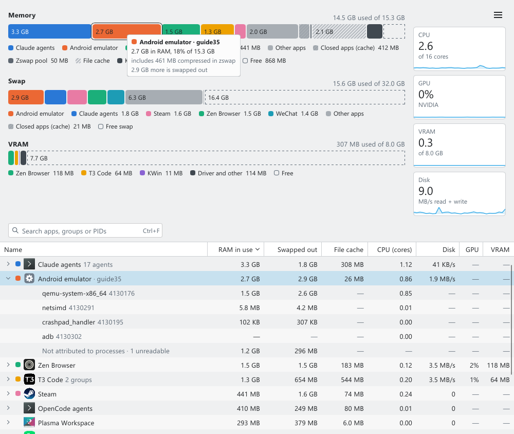
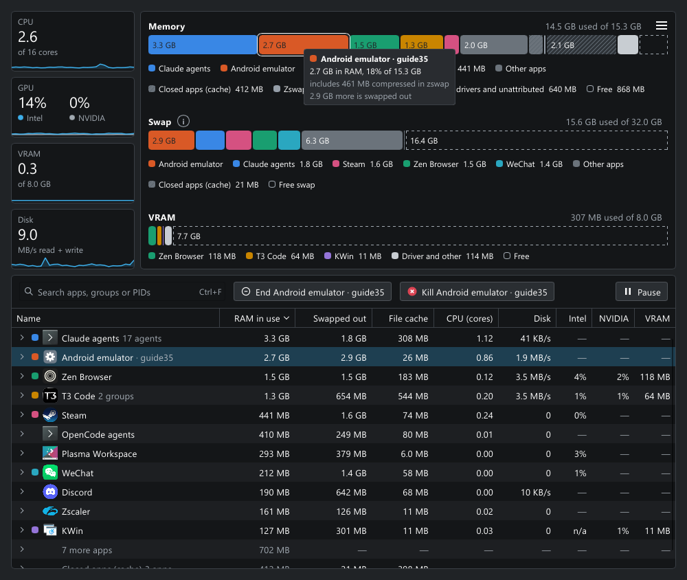
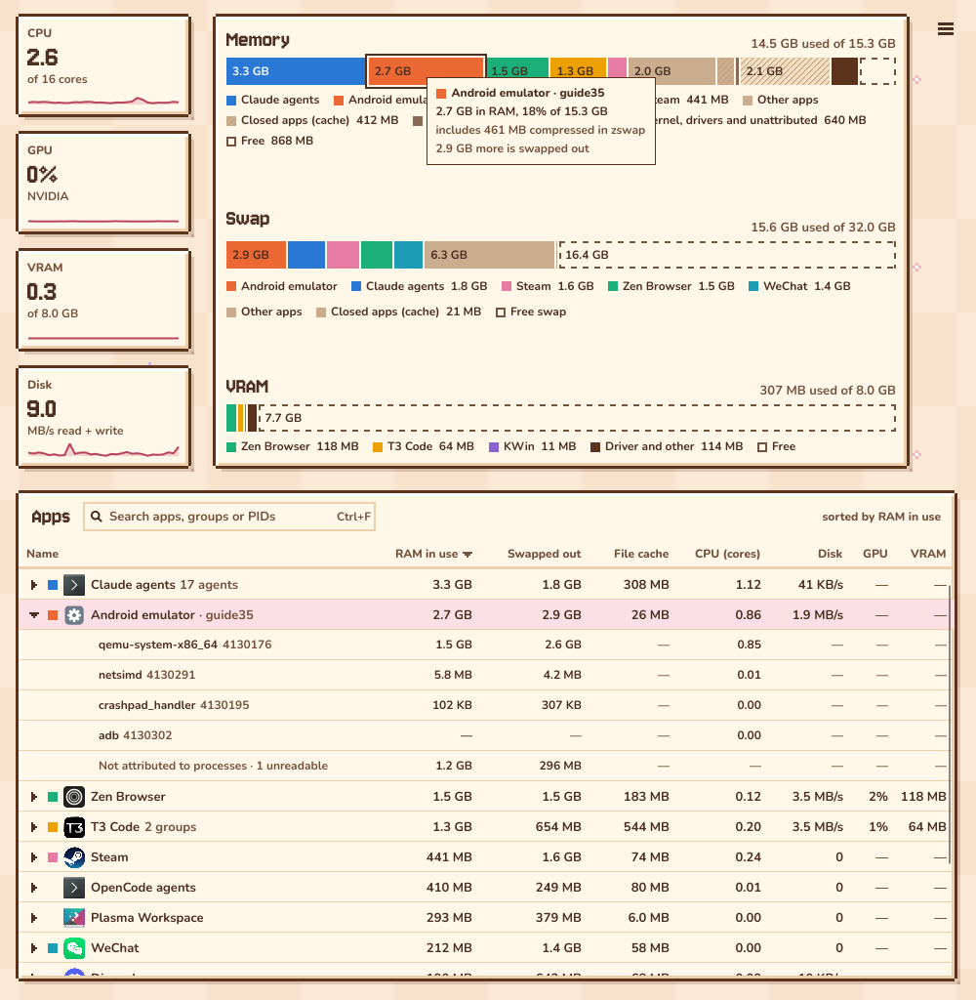

<p align="center">
  
</p>

<h1 align="center">SebWatch</h1>

<p align="center">
  Where did my RAM go? A Linux resource monitor whose numbers <strong>add up</strong>:<br />
  RAM, swap and VRAM per app, background services and emulators included.
</p>

<p align="center">
  <a href="#get-it">Get it</a> · <a href="#what-you-see">What you see</a> ·
  <a href="#build-from-source">Build from source</a> · <a href="#licence">Licence</a>
</p>

<p align="center">
  
  <br /><sub>Breeze Light, with the Android emulator expanded into its processes</sub>
</p>

<table>
  <tr>
    <td width="50%" align="center" valign="top">
      <br />
      <sub>Breeze Dark</sub>
    </td>
    <td width="50%" align="center" valign="top">
      <br />
      <sub>SebChat</sub>
    </td>
  </tr>
</table>

## What it does

- **Every MB accounted for.** The RAM bar adds up to your total RAM: each app, the zswap pool,
  file cache, kernel and drivers, and free. No unexplained gap between "used" and the apps.
- **Every app, window or not.** It reads the kernel's own per-app accounting (cgroup v2), so an
  emulator started as a background service, or a build an agent spawned, counts toward the app
  that started it.
- **Live.** It refreshes every 2 seconds while you look at it and does nothing while minimised.
  Nothing is recorded: the tiles' small graphs keep only the last minute, in memory.
- **No daemon, no root.** Everything comes from files a normal user can read.
- **At home on KDE Plasma.** Breeze Light and Breeze Dark follow the desktop's light or dark, or
  pick the SebChat theme from the menu.

## Get it

| Needs | Why |
|---|---|
| **Linux** with cgroup v2 and a systemd user session | Each app the desktop starts runs in its own group, which is what SebWatch reads |
| **NVIDIA driver** (optional) | For GPU and VRAM readings; without it the VRAM bar and the GPU and VRAM tiles are hidden, and the table shows — in their columns |
| **Rust** (stable) and the fontconfig and xkbcommon development packages | To build it: `fontconfig-devel libxkbcommon-devel` on Fedora |

There are no packages yet. From a checkout:

```sh
scripts/install      # builds a release and installs it into ~/.local
scripts/uninstall    # removes exactly what install put there
```

Both take another prefix as an argument (`scripts/install /usr/local`). SebWatch then appears in
the app menu under System. The chosen theme is kept in `~/.config/sebwatch/settings`.

## What you see

Top to bottom:

1. **RAM bar.** The five biggest apps in their own colours, then other apps, zswap pool, file
   cache (hatched: the kernel frees it on demand), kernel and drivers, and free. Hover a segment
   to name it.
2. **Swap bar.** How much of each app sits in swap, naming the five biggest users of swap.
3. **VRAM bar** (NVIDIA only). Each app's VRAM, naming the five biggest users, the driver's share, and free. While the GPU
   sleeps it says so, and SebWatch doesn't wake it.
4. **Tiles** for CPU, GPU, VRAM and disk beside the bars, under the menu button that switches
   theme.
5. **App table.** Name and icon, RAM in use, swapped out, file cache, CPU in cores, disk, GPU
   and VRAM, sorted by RAM; click a column's header to sort by it, again to reverse. An app
   keeps one colour in every bar and in the table. Press Ctrl+F to find an app by name, group or
   PID. Expand an app to see its processes, and an app made of several
   groups (17 Claude agents, say) group by group.

[docs/accounting.md](docs/accounting.md) says where every number comes from.

## Footprint

With the window open, SebWatch uses about 2.3 % of one CPU core and 100 to 125 MB of memory,
most of it the graphics driver every GPU-drawn window loads. Minimised or hidden, it reads nothing and uses
no CPU. `scripts/bench` measures it; [docs/design.md](docs/design.md#footprint) has the details.

## Build from source

```sh
cargo run -p sebwatch     # start it from the checkout
scripts/check             # cargo fmt, clippy and the tests, one line per step
scripts/screenshots out/  # draw the window in each theme offscreen, with sample data
```

`crates/core` reads and accounts (cgroups, `/proc`, NVML) with no UI and is tested headless;
`crates/app` is the [Slint](https://slint.dev) window. The direction is in
[docs/design.md](docs/design.md), settled choices in [docs/decisions.md](docs/decisions.md) and
the backlog in the [issues](https://github.com/S-Sebb/SebWatch/issues).

## Licence

SebWatch is under the [MIT licence](LICENSE), Copyright (c) 2026 S-Sebb. Its window is built with
[Slint](https://slint.dev), under Slint's royalty-free licence:

<a href="https://slint.dev"></a>

Screenshots are drawn offscreen from sample data, not from a real PC.
